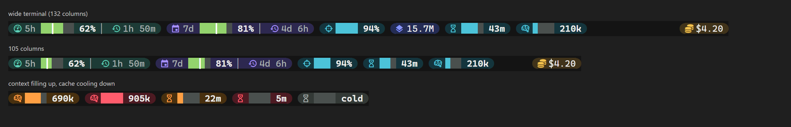
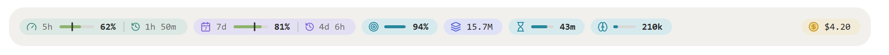

# claude-usage-band

A Claude Code plugin marketplace with one mod, `usage-band`: a band above the prompt showing quota, cache hit rate, context, cache warmth and session cost.

Preview renders:





## Pills

| Pill | Shows |
| --- | --- |
| 5h | Percent of the 5-hour quota left. The bar is the quota left, the tick is the time left in the window; shows the time until reset. |
| 7d | Same for the 7-day quota. |
| Fable | On a Team plan, which has no all-model 7-day quota, the Fable 7-day quota takes the 7d pill's place. It is Claude Code's saved reading from its own config file, which the band refreshes automatically about every 20 minutes by running `claude -p /usage` in the background (no model call, no window; `claude` must be on your PATH). If that fails, the last reading stays and is drawn dimmed once it is more than an hour old (the pill's alt text says how old), and it is hidden once its week has ended. It shows as a sparkle with the label Fable; narrow terminal rows show the sparkle alone. |
| Cache hit rate | Share of the session's prompt tokens read from the cache: cache reads over input, cache writes and cache reads (output not counted). Bar and colour by rate: 80% and up calm, 50-80% amber, under 50% red. Hidden until a request has sent prompt tokens. |
| Cache reads | Tokens read from the prompt cache. |
| Cache warm | Time the main thread's prompt cache stays warm after its last response: `57m`, `<1m`, or `cold`; bar and colour show the share of the TTL left. |
| Context | Tokens of the last request. Bar and colour by fill: under 60% calm, 60-85% amber, over 85% red. |
| Cost | Session cost in US dollars. |

## When figures update

- After every API response: quota, cost, context fill, cache hit rate, cache reads and the cache countdown.
- Reset countdowns redraw every 30 seconds.
- Cache hit rate, cache reads, context and the cache countdown start over on `/clear` and on resume.

## Requirements

- Claude Code v2.1.287 or later (mods).
- Draws in the terminal and in the Desktop app Code tab.
- Terminal icons and round pill ends need a Nerd Font (e.g. CaskaydiaMono Nerd Font). Without one, set `glyphs` to `unicode`.

## Install

Inside Claude Code:

```
/plugin marketplace add brooklyn96/claude-usage-band
/plugin install usage-band@claude-usage-band
```

From a shell:

```
claude plugin marketplace add brooklyn96/claude-usage-band
claude plugin install usage-band@claude-usage-band
```

In an open session, run `/reload-plugins` to pick it up.

Update:

```
claude plugin update usage-band@claude-usage-band
```

## Options

`glyphs`: `nerd` (default) or `unicode`. Set it through `/plugin` (configure).

`cacheTtl`: `1h` (default) or `5m` — how long the main thread's prompt cache stays warm, and so what the warm pill counts down from.

## Narrow terminals

When the row does not fit, the cache pill drops first, then bars shorten and time labels go compact, then the cache hit rate pill hides too, then every pill wraps onto the next line at full size.

## Development

```
claude plugin validate usage-band
claude plugin test usage-band
```

Type-check after the mod has loaded, since the engine writes `usage-band/.claude-plugin/types` on load:

```
npx -y -p typescript@5.6 tsc -p usage-band --noEmit
```

## Security

A mod runs with your permissions. This one makes no network calls, writes no files and starts no processes.

## License

MIT.
